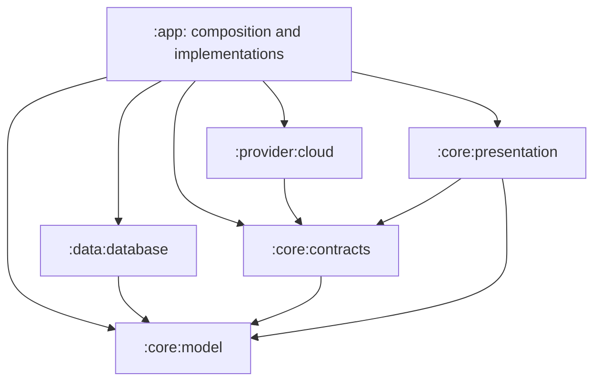

# Gradle module ownership and migration plan

Status: six production modules and the maintained boundary baseline are locally accepted, 2026-11-09. Section 11 records the latest acceptance. Further module extraction is deferred until a useful closed boundary is demonstrated. Device/runtime acceptance, remote CI execution and clean/plugin-change build timing remain unverified.

The first delivery starts from master at `5155a68db87f1dacb010ee2298eb08cf6e89bde6`. Existing [development contracts](README.md) remain authoritative. This document records source ownership and migration gates; it does not change product behavior.

## 1. First-delivery modules

`core` is a directory and Gradle path prefix for named shared responsibilities. There is no catch-all `:core` project or umbrella dependency.

| Module | Current responsibility | Project dependencies |
| --- | --- | --- |
| `:app` | Application composition, embedded Local inference, runtime owners and native/browser clients | All three core modules, `:data:database` and `:provider:cloud` |
| `:core:model` | Shared message, citation, token, Run/effect and identity values; pure transition, generation-boundary, image-bound and action-projection rules; model constants | None |
| `:core:contracts` | Provider/tool contracts and events, invocation context, cancellation, errors, diagnostic context, required embedding/shell configuration values and invocation defaults | `:core:model` |
| `:core:presentation` | Deterministic assistant/timeline/citation projections and context-display calculations | `:core:model`, `:core:contracts` |
| `:data:database` | Room entities/DAOs/migrations, read snapshots, persistence bounds and related tests | `:core:model` |
| `:provider:cloud` | Network providers, HTTP/retry, protocol serialization/parsing, request costs and tokenizer implementation | `:core:contracts` (exports `:core:model`) |

All three core projects currently use the Android library plugin and the Compose compiler. `ChatMessage.preparedMarkdown` retains its existing Markdown `State.Success` type, and existing Compose stability metadata remains effective. Forcing these projects into Kotlin/JVM by removing fields or annotations would change the boundary's behavior. A future JVM conversion requires its own dependency and stability evidence.

Existing package names are preserved. Module paths do not rename persisted types, serializers or reflection entry points. No Kotlin Multiplatform conversion, DI framework or toolchain upgrade is included.

## 2. Current source ownership

### core:model

The module owns 25 relocated model files and `ModelConstants`. These cover messages/segments, attachments, citations, context budgets, model identifiers and thinking controls, token values, Run state/effects/identity, `ConversationRuntimeReducer`, generation boundaries and `RunUiProjection`.

`ConversationRuntimeTrace`, `RequestTokenUsageAccumulator` and `ImageArtifact.hasMeasuredFactsFor` remain in app because their actual collaborators remain there. `MessagePersistenceGuard` moves to `:data:database` in the second extraction. App's old `Constants` entry points forward the relocated model constants without changing values. The original model annotations, serialized/transient fields, defaults and packages remain intact.

Four existing operations/types become public for real consumers across the module boundary: `MessageGenerationBoundary`, `MessageGenerationBoundaryResolver`, `isQwen38ModelId` and `TokenUsage.addCounts`. Other internal helpers retain their visibility. The module owns 15 original test classes (88 methods) and their reducer fixture; app-specific model tests stay in app.

Forbidden dependencies: application Context/services, Room, DataStore managers, provider implementations, HTTP clients, Compose widgets, WebUI, concrete repositories and runtime controllers. The existing Markdown model type and Compose annotations are explicitly retained dependencies, not rendering or lifecycle ownership.

### core:contracts

The module owns the neutral portion of `LlmProvider.kt`, including `StreamEvent`, `ProviderConfig`, `ProviderRequestInput` and `ProviderRequestResolver`; tool definition/result/event contracts; `GenerationContext`; `GenerationCancelHandle` and `StreamScope`; typed generation errors and their serializer; built-in tool-name normalization; `EmbeddingModelConfig`, `ShellDeviceConfig`, Ask User timeout values and `GenerationDefaults`.

OpenAI wire DTOs, usage conversions, `PendingToolCall` and `ProviderRequestPreparation` move to cloud in the third extraction. The existing canonical projection and cost behavior are retained; app supplies the resident Local token counter explicitly. `GenerationContracts.kt` retains implementation-facing admission, provider-instance configuration and Compact declarations. Settings managers and prompt catalogs remain in app; their existing constant entry points forward the shared invocation defaults. The serialized `DiagnosticRequestContext` and unchanged Conch channel/authentication exception types belong to contracts, without diagnostic storage or encryption implementations.

`StreamScope` retains the same handle collection and cancellation behavior. Moving its definition creates no new scope or owner. The module owns the 19 original generation-error tests and four cancellation tests covering independent scopes, unregister, cancellation failure and duplicate handles.

No generic plugin framework, extra repository interface or duplicated transport DTO is introduced. Opaque protocol extension/replay fields remain part of their existing contracts.

### core:presentation

The module owns five production files:

- `AssistantMessagePresentation.kt`: assistant content and timeline projection.
- `MessageSegmentProjection.kt`: segment filtering, grouping and terminal/error predicates extracted from `MessageItemSegments.kt`.
- `CitationMarkdownProjection.kt` and `CitationMarkdownLinkWrappers.kt`: shared citation projection and source-position handling.
- `ContextDisplayCalculations.kt`: reserved-token and Compact-threshold display calculations.

The contracts dependency supplies the existing built-in tool-name normalization and local-context error code. It does not pull provider implementations into presentation.

Compose widgets, effects, remembered state, appearance keys/controllers, resources, animation, scrolling, media IO and browser rendering remain in app. Native and browser renderers consume the shared projections without a shared rendering engine or a new state owner. Shared effective-control resolution and generation-parameter validation now live in app's `presentation/ConversationControls.kt`, separate from Compose collection and actions. Their settings/configuration types remain app-owned, so they are not part of this Gradle module.

Twenty-two original test methods move into this module. Mixed integration classes retain 51 methods in app with unchanged class/method identities and bodies. The citation fixture is test-only and identical in both independent test source sets; it creates no production owner or test identity.

### data:database (second extraction)

This module owns all 58 files formerly under `data/local`, `ChatDatabaseReadSnapshot`, `MessagePersistenceGuard`, and narrow database constants/recovery diagnostics. Packages, Room version, queries, migration SQL and persistence budgets stay unchanged. The existing 46 schema files remain at `app/schemas` as the sole KSP schema history. App's constant and recovery-log entry points forward to the new owners.

The module depends on `:core:model`, Room and the existing serialization/runtime dependencies. It retains the Compose compiler because the original database entities carry inferred stability metadata even without explicit source annotations. It has no dependency on app, runtime, services or repositories. Read snapshots preserve their separate DEFERRED transaction, cancellation and connection-close behavior.

Direct database/migration/persistence tests follow their owner: 50 test classes contain 168 original source methods, producing 178 cases under the retained multi-SDK configuration. `KeywordSearchRoomTest` keeps its three repository integration methods in app and moves its exact query-plan method to the same-named database test class; the internal SQL constants remain internal. Tests that exercise app repositories, workers or source contracts stay in app. Internal helpers stay internal unless an existing app consumer requires the operation. Repository maintenance, imports, workers, process registries and Run/queue/Stop ownership remain in app. No schema or data migration is introduced by this extraction.

## 3. Dependency direction and state ownership

Arrows mean compile dependency, not runtime data flow:

AppContainer remains the composition root. Existing process registries, per-conversation lifecycle authority, Run identity fences and Room transaction boundaries remain unchanged. A module boundary creates no coroutine scope, scheduler, cache, queue, database or recovery sweep and does not authorize eager initialization.

Kotlin `internal` access is module-scoped. Keep cohesive helpers/tests with their owner or review a specific public operation with actual consumers. Do not use blanket public visibility, production friend paths, generic service locators or copied DTOs. Nullable public properties consumed across modules may require a local value for Kotlin smart casts; this must preserve the original predicates and branches.

## 4. Build and behavior safeguards

- Root source-size checks continue to scan app, core, database and cloud source/test roots. Existing file limits remain unchanged.
- `verifyModuleBoundaries` checks the declared project dependencies in every configuration after project evaluation, without resolving configurations. The six production modules must exist; root and empty namespace parents are allowed. New projects and edges outside section 3 fail with source/configuration/target diagnostics, including test and flavor edges. AGP test-component links to the same module are excluded only on resolvable, nonconsumable `*UnitTestCompileClasspath`, `*UnitTestRuntimeClasspath`, `*AndroidTestCompileClasspath` and `*AndroidTestRuntimeClasspath` configurations. Every cross-project edge in those configurations is still checked, as are self-dependencies in ordinary declaration scopes. The gate runs through every `check`, `test` and Android `preBuild`, so local and CI entry points share the same policy. Removing an allowed edge remains valid. New module ownership or dependency directions require an explicit update to both this document and the reviewed allowlist in `ModuleBoundariesPlugin.kt`; its tests also verify the allowlist stays acyclic.
- CI runs application, all three core modules, database, cloud and build-logic tests and retains their reports. Existing Play-specific selection is unchanged.
- The local test-isolation init script includes all Android-library unit-test variants. Database tests retain bounded Android sandbox workers (16 classes per worker, two workers, 1 GiB heap); pure core tests reuse smaller workers. Application F-Droid/full and Play-specific selection retain their original aggregate membership. Timing-sensitive keyword benchmarks use the existing fresh-worker serial partition. Copied partition dependencies resolve lazily and exclude the two partition tasks themselves, avoiding recursive project configuration and task cycles.
- Independent project tasks may run in parallel under Gradle's worker limit. The local full gate retains four workers. When selected together, app's timing-sensitive serial partition precedes the ordered library test suites, which precede app Android batches; R8 and vital lint wait for all selected tests. These ordering constraints add no tasks to focused invocations and preserve every test's worker isolation. Compilation may still overlap tests. Remote CI uses the tracked parallel setting but not the private local ordering policy and requires its own execution evidence.
- `build.ps1` remains the no-argument final gate: aggregate tests and F-Droid release assembly with the existing 600-second hard deadline. No tests are hidden, caches deleted or deadline enlarged to accommodate extraction.
- Room schema history, database version, transaction semantics, serializer names/defaults, archive formats and opaque replay fields must remain unchanged. This delivery requires no data migration.
- App's Android compatibility transform keeps `InstrumentationScope.ALL`, including library bytecode. R8/reflection rules, flavor factories, JNI names/ABI and native packaging retain their existing owners.
- Compose stability annotations/compiler metadata remain effective. Pure projection equivalence and automated UI tests are evidence separate from live device acceptance; compilation alone does not prove UI equivalence.
- Compare exact `classname#method` identity sets across current app/core/database/cloud test reports. The original 4599 unique identities must remain, plus the four first-delivery StreamScope tests. The second extraction preserved the resulting 4603 identities exactly; the third adds only the 12 named regression identities described in section 9. Historical report directories are not current test membership.

The extractions retained package/comment-only placeholders at wholly relocated app paths because the editing interface provided native write/edit but no delete operation. They contain no duplicate declarations. Partial files retain only app-owned declarations.

## 5. First-delivery phase gates

| Phase | Exit evidence |
| --- | --- |
| Baseline | Source revision, original test identities, schema/artifact evidence and original full-build result recorded. |
| Model | Independent model tests pass; app consumers compile; no reverse project dependency; Compose metadata retained. |
| Contracts | Provider/tool integration and cancellation checks pass; no implementation/settings-manager dependency or public visibility sweep. |
| Presentation | Existing projection inputs produce equivalent outputs; mixed native/WebUI/Remote integration tests remain discoverable; UI ownership unchanged. |
| Acceptance | Complete scoped review, exact baseline test identity preservation and fresh `build.ps1` succeed. Report runtime/UI limits separately. |

Do not mix extraction with data-model redesign, dependency upgrades, new product features or speculative fixes. Source-reading tests may update path lookup but must retain their assertions. A discovered regression blocks acceptance until repaired. Git, deployment and publication actions require separate current authorization.

The baseline full build took 374.837 seconds with existing caches. The accepted post-extraction build took 521.365 seconds within the unchanged 600-second deadline. These are not comparable performance samples or a promised improvement: cache state, compiled variants and executed task sets differ. Any build-performance claim needs controlled, repeated measurements.

Local acceptance on 2026-11-09 preserved all 4599 baseline `classname#method` identities exactly and added four StreamScope tests, with no duplicate executions, no failures and the same five skipped tests. All 46 Room schema files remain equivalent to HEAD after newline normalization. Seven representative Compose stability metadata checks passed. The final APK's two DEX files contain no references to the unsupported Java List/ArrayList/AbstractList `removeFirst` or `removeLast` Object-returning methods covered by the compatibility transform. Live device UI validation and remote CI execution were not performed.

## 6. Database acceptance and later modules

The database extraction passed local acceptance on 2026-11-09. Its first full gate timed out at the unchanged 600-second deadline after all tests had passed. After enabling bounded cross-project parallel execution and keeping library test workers after the local app serial partition, the fresh no-argument full gate completed in 432.394 seconds. Compilation cache state also differed, so this result proves the gate passes but does not measure a parallelism-only speed improvement.

Fresh app/core/database reports preserve exactly 4603 unique `classname#method` identities, with zero failures/errors, five original skips and no duplicate executions. The identity-set SHA-256 is `f654671dc62f934b1c454c82fa7af11076a06e9853152b42b9cb84ff0d4b5193`. All 46 Room schemas remain structurally and newline-normalized equivalent to the baseline, and five database entity stability-metadata comparisons pass. The new APK has two DEX files with no forbidden compatibility-transform references, and 22 arm64 native libraries including PRoot/talloc. Database source ownership, app consumers, test paths, Gradle/CI wiring and local scheduling received scoped review. Real-device UI/runtime acceptance and remote CI remain separate, unperformed checks.

The remaining modules are candidates, not requirements for the accepted deliveries:

| Candidate | Intended contents | Preconditions / exclusions |
| --- | --- | --- |
| `:provider:cloud` (completed; see section 9) | Network providers, wire DTOs, request building, stream parsing and tests | Depends on model/contracts. Settings, diagnostics and image IO retain their existing owners. Cloud providers remain together. |
| `:runtime` | Shared conversation execution, generation, queue/Stop/Compact/finalization, automation and selected-owner recovery | Android library initially. Resolve repository/internal/resource/registry lifetimes first. App assembles concrete providers/tools. No split foreground/background engines. |
| `:feature:remote` | Filo sessions/transport, Remote ViewModel and screens | Use model/presentation and optional shared chat UI. Filo retains execution/durable ownership; no local runtime/Room dependency. |
| `:feature:webui` | Embedded HTTP/TLS service, session protocol, assets and adaptation | Consume the existing runtime and presentation; no second generation/persistence pipeline. |
| `:ui:chat` | Shared native messages, Markdown/details and required theme/resources | Optional after pure projections. Native chat and Remote must consume it without app/runtime implementation dependencies; dedicated Compose validation required. |

Future dependency directions are `app -> implementations`, `runtime -> contracts/model/database`, `provider:cloud -> contracts/model`, `database -> model`, `webui -> runtime/presentation` and `remote -> model/presentation` plus optional chat UI. Database must not import runtime; providers must not import native UI/settings owners; feature clients must not access internal DAOs.

Settings, backups, Phone Use, MCP, sandbox and concrete tools may remain in app. Local llama.cpp/JNI, PRoot and flavor-specific native packaging are deferred and require a separate native/resource/reflection review before extraction. Do not pre-create empty modules, one module per screen/provider/tool, `core:common`, `core:utils` or speculative API/implementation pairs.

Android's modularization guidance is supporting context: [overview](https://developer.android.com/topic/modularization) and [common patterns](https://developer.android.com/topic/modularization/patterns). Actual source consumers and ownership determine these boundaries.

## 7. Assessment before the database extraction, 2026-11-09

This section records the completed first-delivery assessment; its inventory is the pre-database baseline. The owner subsequently authorized the bounded database extraction described above. The other proposed phases remain deferred.

The first delivery is complete. Further extraction has value, but no finding requires an immediate whole-application rewrite or stopping feature work. The current structure enforces shared foundation boundaries; it does not yet isolate the major implementation areas.

Current production Kotlin inventory counts physical lines, including comments and blanks, under main/fdroid/play and excludes generated output:

| Module | Kotlin files | Physical lines |
| --- | ---: | ---: |
| app | 821, including 33 relocation placeholders | 158958 |
| core:model | 26 | 3178 |
| core:contracts | 11 | 702 |
| core:presentation | 5 | 875 |

The three core modules own 4755 lines, or 2.9% of this inventory. This is not an architecture completion percentage: a small shared contract can enforce a boundary used throughout the application. Preserved package names also mean an import containing ui or viewmodel is not by itself a dependency on app; inspect the declaration's Gradle owner.

The main remaining concerns are:

- Model still exposes Markdown State.Success through ChatMessage.preparedMarkdown, so the shared foundation remains coupled to Android/Compose/Markdown. Removing that dependency requires a separate rendering-state design and compatibility assessment; it is not a prerequisite for the next storage extraction.
- ChatRuntime references automation coordinators, LoopManager and TaskExecutionEngine, while TaskExecutionEngine references app generation, request, registry and finalization implementations. These package dependencies describe one candidate execution responsibility, not two independent modules to move by directory. No runtime initialization cycle or product failure was demonstrated.
- WebUI still receives concrete execution objects from AppContainer. Shared effective-control validation also remains in ConversationSettingsWorkspace. Remote has a different external execution owner but still uses app-owned message/Markdown preparation helpers. Client extraction therefore needs explicit existing execution entry points and completed shared-presentation ownership first.
- Storage is relatively cohesive: data/local has 58 Kotlin files and 6176 lines. Migration19To20 depends on the app-owned internal MessagePersistenceGuard.TRUNCATION_MARKER, and database read-snapshot/DEFERRED-transaction handling is outside that directory. ConversationRepository also owns maintenance and subagent Job concerns, so the whole repository layer must not be swept into a database module.
- The four cloud-provider directories have 24 files and 5942 lines, excluding shared support. ProviderRequestPreparation reaches ContextCostModels and LocalModelRuntime; StreamingJsonRequestBody uses app image/file handling; HTTP diagnostics reach runtime trace types. A cloud module needs these actual dependencies resolved without a catch-all utility module or copied DTOs.

Recommended next implementation order is a bounded data:database extraction, followed by provider:cloud once its request/image/cost dependencies close. Runtime boundary preparation can happen within app alongside that work; the actual runtime module should follow storage/provider ownership and client-entry decisions. WebUI and Remote then become separate candidates, with shared native chat UI extracted only when its concrete consumers justify it. This is an assessment, not authorization to start these phases.

The next database scope should include Room database/entities/DAOs/migrations/schema, directly related persistence validation/read snapshots and their tests. Keep repository orchestration and lifecycle ownership in app. Stop and reconsider the boundary if it requires a reverse app dependency, blanket public visibility, duplicated state owners or weakened transaction/cancellation guarantees.

Build speed is unproven. The accepted 521.365-second full build leaves about 79 seconds below the fixed deadline; the 374.837-second baseline differs in caches and executed work. No incremental-edit benchmark or runtime-performance benefit was measured. Further modules should be justified by enforced ownership, isolated verification or a measured development bottleneck, not a target module count.

Before another broad migration, close the current delivery's real-device acceptance gap for native chat/streaming, Stop/queue, citations, Remote and WebUI as applicable. Preserve exact test membership and data contracts in each subsequent phase, and keep the existing build deadline. This assessment performed no product changes, new build, deployment or remote CI run.

## 8. Assessment before cloud extraction, 2026-11-09

This section records the accepted post-database assessment. The owner subsequently authorized bounded cloud boundary preparation and extraction; its implementation and acceptance are recorded in section 9.

Both authorized extractions are complete and locally accepted. The repository now has five production Gradle projects; the included build-logic project remains build tooling. Existing compiler-enforced dependency directions are acyclic, and no extracted module depends on app. Rechecked build-log and APK hashes match the accepted second delivery; assessment does not imply a new test or device run.

The current production inventory uses the same physical-line convention as section 7:

| Module | Active Kotlin files | Relocation placeholders | Physical lines |
| --- | ---: | ---: | ---: |
| app | 728 | 93 | 152559 |
| core:model | 26 | 0 | 3178 |
| core:contracts | 11 | 0 | 702 |
| core:presentation | 5 | 0 | 875 |
| data:database | 62 | 0 | 6604 |

The four extracted modules own 104 production files and 11359 lines. App's remaining source includes roughly 63128 UI lines, 23905 ViewModel/runtime-package lines, 14506 data-package lines and 13905 API-package lines, excluding placeholder lines in those package figures. These are overlapping architectural responsibilities grouped by package, not proposed module boundaries or a completion percentage. Source-size reduction is secondary to preventing reverse dependencies and keeping one owner for each lifecycle and transaction.

The database boundary is complete for its approved scope. Do not move ConversationRepository wholesale into it: its constructor and state still connect database reads/writes to maintenance scheduling, attachment work, Android context and Subagent Job lifetimes. Keeping those consumers in app is intentional. The extracted core modules also intentionally retain Android/Compose/Markdown dependencies; they are not yet platform-neutral JVM libraries.

The focused reviews identify existing seams rather than a need for new generic interfaces. ProviderRequestPreparation.resolveRequest already accepts the contracts-owned ProviderRequestResolver, but its fallback cost selection has a source dependency on LocalModelRuntime; only the LOCAL branch invokes local token counting. StreamingJsonRequestBody reaches app image/file handling, and HttpClient diagnostics reach ConversationRuntimeTrace. On the client side, AppContainer injects the existing shared execution owners into WebUiChatSession. RemoteMessageHydration still uses app MessagePayloadProjector, payload caching and Markdown preprocessing, while Remote transport reaches app encryption, secrets and diagnostics. These dependencies must retain their current execution, cancellation, security and cache semantics during any later ownership change.

The recommended immediate step is acceptance and stabilization, not another large directory relocation. Native chat/streaming, Stop/queue, selected-owner recovery, archive restore/export, semantic search, Remote and WebUI still lack fresh device acceptance. The tracked parallel-build setting also has no remote CI execution evidence. The 432.394-second local gate is 167.606 seconds below the fixed deadline, but differing caches/tasks mean neither it nor the earlier failed run establishes a controlled build-speed improvement. Benchmark a representative incremental edit before using build performance to justify more modules.

Further extraction should follow these concrete readiness conditions:

| Priority | Candidate | Current judgment and prerequisite |
| --- | --- | --- |
| Next bounded preparation | Shared controls/presentation and cloud-provider request boundary | Move only proven multi-consumer pure rules toward their existing core owner, after closing settings/value dependencies; separate cloud request costs from embedded LocalModelRuntime and image/diagnostic IO ownership inside app first. Do not add a catch-all utility module. |
| Next Gradle module candidate | provider:cloud | Four cloud implementation folders contain 24 files / 5942 lines, but their shared request/image/cost/diagnostic dependencies extend outside those folders. Extract together only when the dependency closure is one-way to existing contracts/model and narrow owned support. No module per provider. |
| Later | runtime | High eventual value because native chat, automation and WebUI share execution. First clarify existing repository, Settings, registry, Job and resource lifetimes inside app; moving viewmodel/automation wholesale would preserve coupling and risk splitting one execution authority. |
| Later | feature:remote / feature:webui / ui:chat | Remote still shares app Markdown/preparation and native rendering; WebUI shares concrete runtime and controls. Close those actual seams before extracting feature directories. Shared chat UI is optional and needs dedicated Compose/device evidence. |

Continue only when a proposed module has a cohesive responsibility, a closed one-way dependency graph, useful independent verification and no new lifecycle authority. Defer it when extraction would require blanket public visibility, friend paths, copied DTOs, a reverse app dependency or duplicated runtime state. The current structure is a reasonable stopping point for structural work while feature development continues. This recommendation authorizes no additional implementation, Git mutation, deployment or publication.

## 9. Bounded cloud extraction, 2026-11-09

Implementation and local acceptance are complete. The 64 existing production files have been relocated: 24 files across OpenAI-compatible, Anthropic, Gemini and Ollama implementations; seven root API files; 14 protocol helpers; 17 cost/tokenizer files; and two HTTP retry files. One new narrow CloudDebugLog implementation supports the app forwarding facade. Cloud now owns 65 production files / 11194 physical lines; app retains 664 active production Kotlin files plus 157 declaration-free relocation placeholders across all three deliveries. This module does not own embedded Local inference, embedding orchestration, shared thinking normalization, application composition or generation lifecycles.

The Android library retains the existing Compose and serialization plugins and depends on core:contracts (which exports core:model) and OkHttp. App explicitly depends on cloud. No database, app or native-engine dependency is introduced. Existing packages, protocol DTOs and serializer fields are preserved; internal declarations are exposed only for concrete app consumers, while internal tests follow their implementation owner.

Cost factories receive the existing resident local-token-count function explicitly at app accounting and Local dispatch entry points. Pure image size/limit calculations have one model owner; attachment ownership, pixel processing and quality settings remain in app, while request serialization retains completed-file validation, replay, cancellation and unavailable-occurrence filtering. DiagnosticRequestContext moves unchanged to contracts. Five callbacks on the existing RequestTrace bind to app diagnostics, preserving child propagation, exchange correlation, live capture checks and redaction. Two unchanged Conch exception types move to contracts so network retry classification retains the same type checks without importing app encryption.

The tokenizer's sole vocabulary remains app/src/main/assets/tokenizers/o200k_base.tiktoken, initialized through the host Context by the existing application startup call. The cloud implementation consumes that cache without a second startup owner. Tests locate this asset and the existing app/src/test/resources/tokenizers/o200k_ref.json fixture from the repository root rather than duplicating either artifact.

CI and local aggregate discovery include cloud tests. Source-reading guards inspect the active cloud paths. Pure protocol tests follow cloud; mixed app integration tests use the public provider entry point and intercept the real serialized HTTP request/body with a test-only fixture. Their existing assertions and method identities remain, including invalid-schema rejection before network IO. The retry integration suite mocks the already shared NetworkRetryPolicy backoff used by the internal provider policy. No production friend paths, reflection bridge or test-only public API is introduced. MessageConverterTest keeps its app estimator and image-projection methods in app and moves the independent converter methods to cloud with the same runner and SDK settings. ContextCostModelTest similarly retains its two app-estimator integration methods in app and moves its seven standalone component methods to cloud.

Local acceptance passed on 2026-11-09. The fresh no-argument build.ps1 completed in 504.625 seconds under its unchanged 600-second deadline, including all selected tests, R8, vital lint and F-Droid release assembly. Fresh reports contain exactly 4615 unique identities: the complete 4603-identity second-delivery baseline plus the 12 named cost, image-limit, trace-correlation and logging regression tests. There are zero failures/errors/duplicates and the same five original skips. The full identity-set SHA-256 is `2db5098c561c76eaa6327a41c818dae6c1e716c3c6492fcbd492fc79dc63dee2`; subtracting the explicit additions reproduces the second-delivery digest exactly.

Full-gate verification exposed two app test fixtures that still mocked only the old logging facade; their cloud logger setup/cleanup now follows the actual owner without changing behavioral assertions. One unchanged SSE test transiently exceeded its existing two-second bound during overlapping suites, then passed in isolation and subsequent full runs. No SSE production logic or timeout was changed. A later full run passed all tests but reached the 600-second deadline during release work. Ordering local library suites between app Serial and Android batches removed their overlap, while preserving all filters, task membership and worker isolation. The accepted run measured database/cloud/app Android tasks at 39.222/17.453/140.049 seconds. These observations validate the current gate; they are not a controlled overall build-performance benchmark or proof of the transient timeout's cause.

All 46 Room schemas remain equivalent to HEAD after newline normalization. OpenAiChatRequest, OpenAiUsage, HttpClient.RequestTrace and DiagnosticRequestContext retain their sampled Compose stability metadata. The accepted APK is 34746925 bytes, SHA-256 `85d74c7b4d8b430b7c7418555372e21671cbbff10ee4723230d306684d8a5a01`. It contains one unchanged tokenizer vocabulary, two DEX files with no forbidden Java collection references covered by the compatibility transform, and 22 arm64 native libraries including PRoot/talloc. Source ownership, cross-module consumers, mixed tests, Gradle/CI wiring and local scheduling received scoped review. Live device/runtime acceptance and remote CI execution remain unperformed. No deployment, commit or publication is part of this acceptance.

## 10. Post-cloud assessment, 2026-11-09

The three authorized deliveries are locally accepted. The current recommendation is to stabilize the six production projects before adding another Gradle module. The bounded review found no current defect that requires an additional module. Further boundary preparation can be useful without starting another directory relocation.

Live assessment confirms six projects and ten project dependency edges, with no cycle or library-to-app dependency. The accepted APK hash still matches section 9. These are actual compile boundaries: model and contracts own shared values and invocation rules; presentation owns shared deterministic projections; database owns storage mechanics; cloud owns network-provider implementations. They do not establish a platform-neutral core or a thin application shell.

The assessment-time inventory below counts active production Kotlin under main/fdroid/play, including comments and blank lines but excluding generated/vendor output and declaration-free relocation placeholders. It predates the app-internal changes in section 11:

| Module | Active Kotlin files | Physical lines |
| --- | ---: | ---: |
| app | 664 | 141158 |
| core:model | 27 | 3199 |
| core:contracts | 13 | 725 |
| core:presentation | 5 | 875 |
| data:database | 62 | 6604 |
| provider:cloud | 65 | 11194 |

The five extracted modules own 172 files and 22597 lines. App additionally has 157 placeholders containing 471 lines; this explains the earlier 141629-line app total. These counts are not an architecture completion percentage. App's largest package groups remain UI (63128 lines), ViewModel/runtime (23920) and data (14506); packages are not proposed module boundaries. The largest active production Kotlin file remains 800 lines.

### Remaining boundaries and readiness

- Runtime is the strongest future candidate, but its dependencies are not closed. ChatRuntime constructs and connects generation, RAG and request assembly while accepting concrete repositories, memory/skill managers, tool providers, sandbox support and LocalProvider. TaskExecutionEngine and foreground execution deliberately share the registry, execution coordinator and Stop/terminal barriers supplied by AppContainer. Do not create separate foreground and automation runtime modules. Relevant owners: [ChatRuntime](../app/src/main/java/com/newoether/agora/viewmodel/ChatRuntime.kt), [TaskExecutionEngine](../app/src/main/java/com/newoether/agora/automation/TaskExecutionEngine.kt) and [AppContainer](../app/src/main/java/com/newoether/agora/di/AppContainer.kt).
- ConversationRepository is intentionally outside database. Its transaction operations coexist with maintenance scheduling, Android snapshot context and Subagent Job membership. A future runtime boundary must decide how those existing operations and lifetimes are supplied; moving the entire repository into database would broaden the accepted storage responsibility. Relevant owner: [ConversationRepository](../app/src/main/java/com/newoether/agora/data/repository/ConversationRepository.kt).
- WebUI has a useful client boundary but directly consumes generation/Stop controllers, repositories, state registry, execution coordinator, settings and attachment processing. WebUiChatSession already implements ChatClient and shares existing runtime operations. Prepare that existing access surface rather than inventing another execution service. Its browser-owned selection/draft/session state stays with WebUI.
- Shared chat UI has real native and Remote consumers, but entire screens still consume concrete ChatViewModel/RemoteViewModel and SettingsRepository. Extract reusable rendering only after separating page composition, resources and state collection. Remote execution remains externally owned and must not acquire Agora's Room or generation runtime. Its raw attachment semantics remain distinct from ordinary model-input processing.
- Markdown and HTML preview cross UI/client paths while enforcing resource access and release lifetimes. Shared preview loaders, shell-image admission and attachment IO need an explicit complete boundary, not relocation based only on a ui package name. Remote-specific protocol projections need not be moved to core merely to reduce app size.
- Core remains Android/Compose/Markdown-based: ChatMessage.preparedMarkdown exposes Markdown State.Success and core:model exports its required dependencies. More Gradle projects would not remove that coupling. A JVM conversion is a separate rendering-state and compatibility decision, not a prerequisite for useful current boundaries.
- Embedded Local inference remains app-owned because SettingsRepository, LocalModelRuntime, native cancellation and resident model resources are coupled deliberately. Its cancellation contract is already in core:contracts. Do not merge it into cloud or create another native-resource owner.

### Recommended next work

| Order | Work | Completion condition |
| --- | --- | --- |
| First | Stabilize accepted modules and close qualification gaps | Device acceptance of native/Remote/WebUI flows and remote CI execution; failures addressed within the existing owners. Preserve a reviewable checkpoint of the uncommitted deliveries when separately authorized. |
| Next bounded structural task | Prepare the shared generation and client access boundary inside app | Existing repository/settings inputs, callbacks and client commands have explicit ownership; the same registry, transaction, Job and native-resource lifetimes remain; independent boundary tests are useful. Start with the concrete inputs shared by ChatRuntime and WebUiChatSession rather than adding a generic facade. |
| Next possible module | runtime | A closed one-way dependency graph exists without a reverse app edge, broad visibility changes or a second lifecycle owner. AppContainer remains application composition. |
| Later, independently assessed | feature:webui, feature:remote or shared chat rendering | Each has its own dependency closure and consumer-driven verification. Remote need not wait for or depend on Agora runtime; native rendering and IO/security dependencies are its separate prerequisites. |

Do not split cloud per provider, database by DAO/entity, or core into a generic utility bucket. Do not create empty feature/API/implementation projects in anticipation of future consumers. The next module should remove a demonstrated responsibility or development bottleneck, not satisfy a module-count target.

The accepted local gate retains 95.375 seconds below its fixed deadline, but 404 of 426 tasks were up-to-date. No controlled clean/incremental build benchmark or runtime improvement was measured. Remote CI selects all library suites but does not load the private local test ordering, so local acceptance is not CI timing/isolation evidence. The earlier transient SSE timeout passed in isolation and final full checks; its precise cause remains unproven. Device/runtime acceptance, remote CI and test robustness matter more immediately than increasing module count.

This assessment changed documentation and the task record only. It did not rerun Gradle, exercise a device, change production/tests, commit, deploy or publish. All three implementation deliveries remain uncommitted. Relocation placeholders remain declaration-free maintenance residue, not duplicated implementations. The review was bounded to module/build wiring and directly relevant runtime/client owners, not a full repository audit or exhaustive dependency-closure proof for future candidates.

## 11. Maintained boundary baseline

The accepted implementation keeps the six production projects. The graph gate in section 4 makes their dependency direction a build invariant; it does not imply that all packages inside app are ready for extraction.

`app/presentation/ConversationControls.kt` owns the shared deterministic conversation-control projection, OpenAI control availability/service-tier resolution, generation-parameter validation and six-field merge. Native Compose and WebUI consume those same functions. Compose state collection, haptics and setting writes remain with their existing clients. The shared declarations stay internal to app because they use app-owned ConversationSettings and CustomProviderConfig. Moving those types or exporting a generic settings facade solely for module extraction is not part of this boundary.

AppContainer supplies ChatRuntime's tool list and existing subagent/loop/shell-confirmation callbacks. The concrete provider instances are captured at the original initialization boundary; list creation and AskUserToolProvider construction remain inside the lazy generation-manager path. AppContainer registers the existing ForegroundAutomationBridgeController only after ChatRuntime binds its registry callbacks. Its Send callback captures that completed runtime directly, without re-entering the chatRuntime lazy property. The registered bridge remains retained by TaskExecutionEngine for the process lifetime.

ChatRuntime still owns client registration, its generation and command controllers, RAG/request assembly, and the single registry callback binding. TaskExecutionEngine retains headless execution. Both paths keep the same AppContainer registry, execution coordinator, Room transactions, Stop barriers and native-resource owner. This removes specific tool/automation composition responsibilities without introducing another controller, dependency bundle, registry, scope or execution path.

For subsequent changes, keep pure rules with their real consumers and preserve client-local state. Add a Gradle project only when the implementation has a closed one-way graph and useful independent verification. A new build boundary must preserve the complete test identity union, storage/serialization contracts, Compose metadata and packaged compatibility checks. Device and remote CI qualification remain separate from local automated acceptance.

Local acceptance completed on 2026-11-09. Independent scoped reviews passed the module gate, shared-control equivalence, runtime composition and the auth fixture repair. The build-logic suite passes all 24 tests, including 11 boundary checks; these are separate from the app/library test union. The actual Android project graph passes with six production modules and ten edges. Ten focused app suites pass all 100 tests with no failures, errors or skips. All 10 auth regression cases also pass, along with their selected Serial and AndroidBatched prerequisites.

The final plain `build.ps1` passed in 450.629 seconds under the unchanged 600-second deadline: 427 actionable tasks, 23 executed and 404 up-to-date. Every selected app/library test task ran again. The unchanged report checker confirms 4615 unique identities, zero failures, errors or duplicates, and the original five skips. Relative to the original pre-refactor commit `5155a68db87f1dacb010ee2298eb08cf6e89bde6`, the union preserves all 4599 original identities and adds 16 explicitly identified tests: four cancellation tests and 12 cloud-boundary tests. Subtracting those additions exactly reproduces the original identity-set SHA-256, `151ba4cbd73e74d7850375093b7a23f76603cf280346b4c52e03538b5b3201b8`. The 4603-identity baseline in section 9 is the intermediate second-delivery baseline. The final union SHA-256 is `2db5098c561c76eaa6327a41c818dae6c1e716c3c6492fcbd492fc79dc63dee2`.

The fresh F-Droid release APK is `app/build/outputs/apk/fdroid/release/app-fdroid-release.apk`, 34748641 bytes, SHA-256 `00de0d4048491a1b3e6f75aa0c2f65374e5963de604214a6740a216828286937`. Acceptance checks preserve all 46 Room schemas, four sampled Compose stability metadata contracts, one tokenizer asset with unchanged logical token/rank lines, and all 22 arm64-v8a native libraries including PRoot/talloc. The tokenizer matches the original Git blob after LF normalization; its CRLF worktree/package bytes are not raw-byte identical to that blob. Both DEX files contain no forbidden Android 15 `List.removeFirst/removeLast` method references.

Two earlier full runs did not qualify this phase. The first hit the fixed 600-second deadline after the tests passed, while release packaging was incomplete; it rebuilt library release/test and app release/Play outputs after the build-logic change. The next run exposed a Windows file-replacement race in an unchanged auth test fixture. The fixture now closes its fully consumed read source before releasing the blocked writer; production auth code, test identity, assertions and timeout are unchanged. Focused verification and the final full build pass after that repair. The successful build uses existing compilation outputs and does not qualify clean or plugin-change builds against the deadline. No build-speed improvement is claimed.

Device/runtime acceptance and remote CI remain unverified. Local private test ordering is not remote CI evidence. The changes remain uncommitted and undeployed; no publication occurred. The 157 declaration-free relocation placeholders remain recorded maintenance residue. Future work should preserve this tested dependency graph and the existing lifecycle owners, and address the remaining qualification gaps before treating further module extraction as a priority.

## 12. Baseline qualification and checkpoint

Structural/local acceptance in section 11 is complete. The remaining gates below qualify the exact delivered revision for repeatable maintenance; they do not require another module extraction. Record each result separately. Installation, compilation and a static workflow review do not count as runtime acceptance.

### Version-controlled checkpoint

The proposed checkpoint is one integrated commit, `refactor: establish maintained module boundaries`. Its scope includes the three accepted module extractions, their original-source placeholders and test relocations, application adapters/composition, module and source-size build wiring, CI/report coverage, shared conversation controls, the reviewed auth test fixture repair, and this document. The intermediate extraction phases share edited files; reconstructing untested intermediate commits is not required to preserve the tested final state.

The reviewed working-tree scope contains 678 files: 367 modified tracked files and 311 new files. Before staging, recheck the path set and content against the accepted scope and exclude unrelated or concurrent edits. Private build/deploy scripts, `.harness`, signing inputs, local SDK configuration, build output and APKs are excluded. Keep the complete reviewed source and tests together; do not omit untracked module sources. A commit or push still requires current authorization. Record the resulting commit SHA rather than treating the pre-change base SHA as the accepted revision.

### CI and build qualification

The existing [Build APK workflow](../.github/workflows/build.yml) checks out a remote revision. It runs build-logic, application and all five library test suites, checks Play behavior, retains their reports, and builds the Linux native runtime and F-Droid release. A run of the old remote master cannot validate these local edits. After authorized publication, require successful test and build jobs for the exact checkpoint SHA and retain their report and APK references.

Record whether caches were restored, which test variants executed, and any skips. Library variant reports may repeat a test identity across variants; compare identity membership within the applicable variant and do not infer a pass from aggregate counts alone. Verify that the reviewed module graph gate is reached. Local private test partitioning is not part of this workflow. A successful remote run establishes that environment's result, not the local 600-second clean-build timing. The latter remains open after the observed timeout; do not remove the deadline or reduce tests to qualify it.

### Device/runtime qualification

Deploy only the section 11 APK after matching its recorded SHA-256, or a newly accepted artifact if code changes. Record transfer hash, installation and launch separately. Installation replaces the running Agora application and can interrupt the agent conversation; allow the user to restore the conversation before continuing, and do not retry deployment merely because the tool call was interrupted. The owner performs UI acceptance unless explicit device-control authorization is granted.

| Flow | Required observable result |
| --- | --- |
| Startup and existing history | The conversation list opens and existing messages, branches and attachments remain readable; opening one conversation does not start unrelated conversations. |
| Native generation and Stop | A configured provider can complete a send; Stop ends an active generation and it stays stopped after reopening the conversation, with no duplicated terminal output. |
| Native/WebUI shared controls | Model-dependent control availability, parameter merge/validation and effective settings agree across both clients; an accepted edit is reflected without a second settings owner. |
| WebUI authentication | Login works, logout revokes the existing session, and reconnecting does not restore the revoked authenticated state. |
| Foreground/background automation | A controlled test task follows the existing visible/headless routing and has one terminal outcome; Stop does not leave a second generation running. |
| Remote and embedded Local | Where already configured, Remote keeps external execution ownership and existing attachment behavior; Local send/cancellation preserves resident-model ownership. Unavailable paths remain explicitly unverified. |

Use disposable test conversations and controlled tasks without changing user configuration or deleting history. External provider/tool calls and device actions retain their normal authorization boundaries. Record actual cases, artifact identity and results; this table is a pending acceptance checklist, not evidence that any device flow has run.

## 13. Complete pre-refactor equivalence review

The complete working tree was compared against `5155a68db87f1dacb010ee2298eb08cf6e89bde6`, the original pre-refactor revision. Source classification covered all 1473 original Kotlin files, including flavor tests: 1115 remain exact at the same path, 195 are exact relocations, 26 change only package/import headers or blank lines, and 137 require semantic review. Classification alone is not a behavior proof. Independent bounded reviews covered those remaining changes and the new declarations across core/shared presentation/runtime, cloud/app adapters, and database/tests. No concrete semantic regression or unresolved review gap was found in that scope.

The review preserves model fields/defaults/serialization, constants, shared projection and validation rules, provider requests and retry/termination behavior, image limits/replay/cancellation, diagnostic correlation/redaction, database queries/migrations/transactions and resource release. Runtime composition retains the same registry, coordinator, repository, scope and native owners; tool order and lazy creation remain unchanged, and registry binding still precedes automation bridge startup. All 4576 original `@Test` methods remain without loss or duplication. Reviewed test adapters preserve assertions, timeouts and performance thresholds; the original 4599 executed identities reconcile exactly as recorded in section 11.

Two internal API changes require explicit bindings at future call sites: directly constructed `RequestTrace` instances default to no app diagnostic callbacks, and Local cost factories default to no exact-token-count callback. Every existing production caller supplies the original bindings. These are module-boundary changes, not a claim that unadapted future callers would behave identically.

The executable evidence combines the final full-build reports with source/test-identity, schema, metadata and packaged-artifact checks. This review did not rerun the unchanged product build. It does not establish binary identity with the original APK, live provider or device behavior, clean-build timing, or the behavior of the five skipped live integration tests. Remote CI and owner device acceptance remain the separate gates in section 12.
